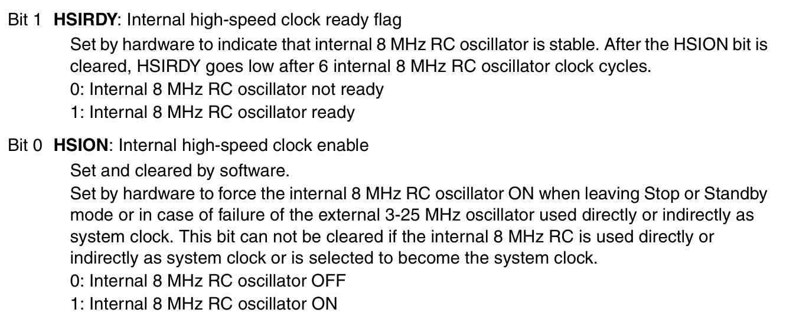
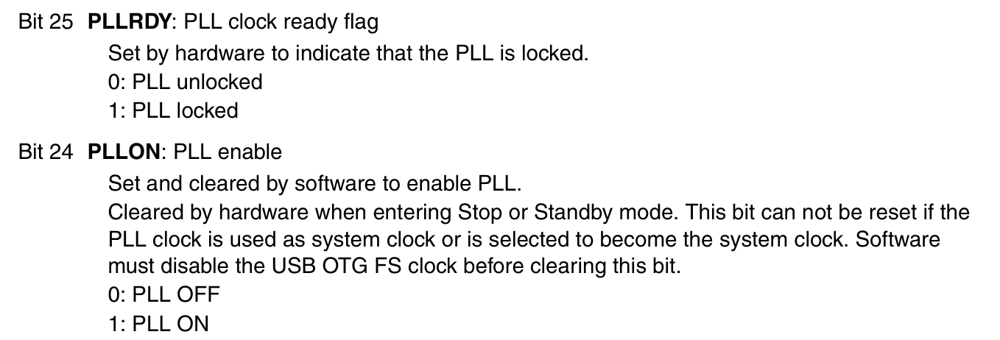
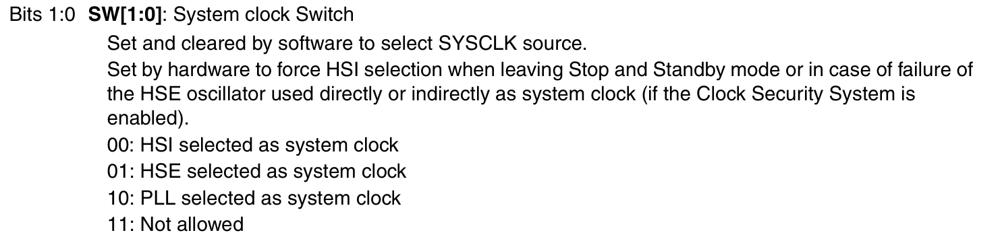
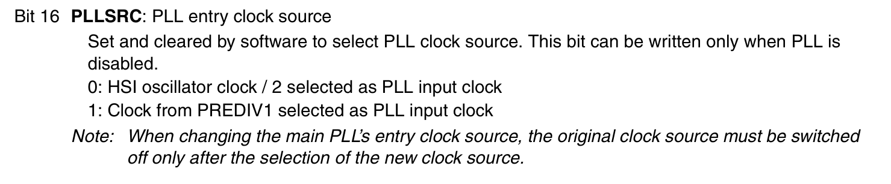
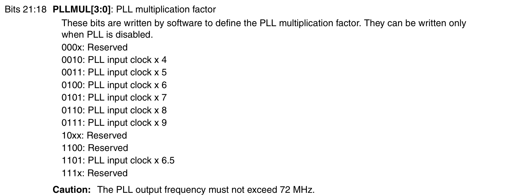
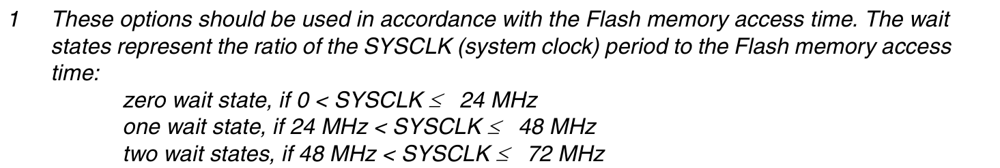

# Configuring Clock Frequency in STM32 Blue Pill
The Normal Clock Frequency as the STM32 boots up is the 8MHz clock, This is the default clock used for crucial processes such as reset and booting
There are other Clock Frequency which can be defined and used in the STM32 Blue Pill
The other main types of clocks are:
- High Speed Internal Oscillator(HSI), This is the 8MHz Oscillator built into the board
- High Speed External Oscillator(HSE), This is clock input given from outside using a Crystal Oscillator on a breadboard
- Phase Locked Loop(PLL), This is the part which multiplies the given clock Frequency to attain faster frequecies for quicker execution

The Phase Locked Loop requires a source, a scale value to configure it properly
- The SysClk defines which is the current clock being used for the MCU.

## Essential Registers and Configuration
- Clock Control Register(RCC_CR)
- Clock Configuration Register(RCC_CFGR)
These are the essential register that contain the bits which are to be manipulated so that we can switch the clock

### CLOCK CONTROL (RCC_CR)

- Bit 0: HSION: Writing to this bit enables the HSI Oscillator which is of 8 MHz
- Bit 1: HSIRDY: We must write a blocking loop that check if this HSIRDY is set or not after setting HSION, This is to ensure that we do not HardFault the system.

- Bit 24: PLLON: We must set this bit in order to make the PLL work, This turns on the PLL unit
- Bit 25: PLLRDY: After setting PLLON we must write a blocking loop to ensure that the PLL is turned on and Ready and locked its signals

### CLOCK CONFIGURATION (RCC_CFGR)

- Bit [1:0]: SW: This register defines which is the clock that is to be used for execution, We can choose, HSI, HSE and PLL as the Clock Frequency for the entire system, Setting this must be done carefully

- Bit 16: PLLSRC: Writing to this register sets which is the source that is to be multiplied, Clearing this bit, i.e Setting this to zero makes the source of the PLL as HSI/2, That is 4MHz as the input frequency of the PLL.

- Bit [21:18]: PLLMUL: This register defines the factor by which the clock frequency should be multiplied, Check the manual for the multipliers and register values

### FLASH REGISTER (FLASH_ACR)
- The Flash ACR has bits[2:0] as the Latency bits, The latency can be 0,1 or 2 based on the SW clock frequency, for more clock frequency more latency

## Step By Step Configuration
1. Turn on the HSION in the RCC_CR Register
2. Write a blocking loop to check if the HSIRDY gets set
3. Write to the PLLSRC in the RCC_CFGR, The proper value, generally 0 for choosing the 8MHz Internal Clock Divided by 2, which gives us 4MHz clock.
4. Write to the PLLMUL in the RCC_CFGR, Look at the register maps and properly set the value into the correct bits for setting the PLL Multiplier
5. Turn on the PLLON, by setting the bit in the RCC_CR
6. Write a blocking loop to check whether the PLLRDY bit is set
8. Write to the FLASH_ACR register based on the frequency you are aiming for.
7. Finally turn on the clock by changing the SW value to `10`, This make the entire system clock to take the PLL output as the main clock.

> [!NOTE]
> There is an very important register called FLASH_ACR which has some bits named LATENCY, These wait states must be choosen based on the clock speed before turning on SW

