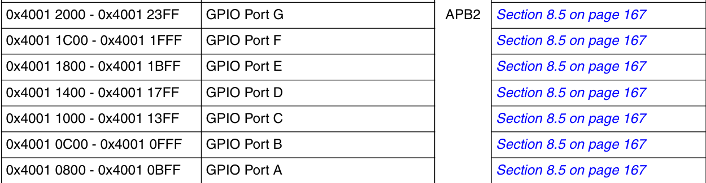
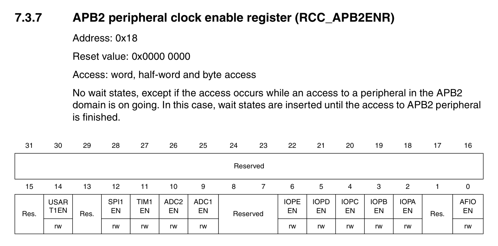
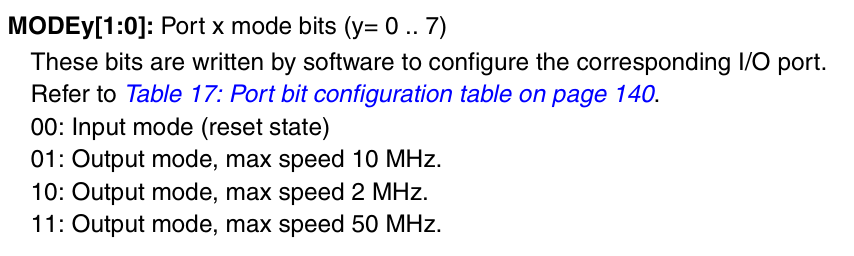
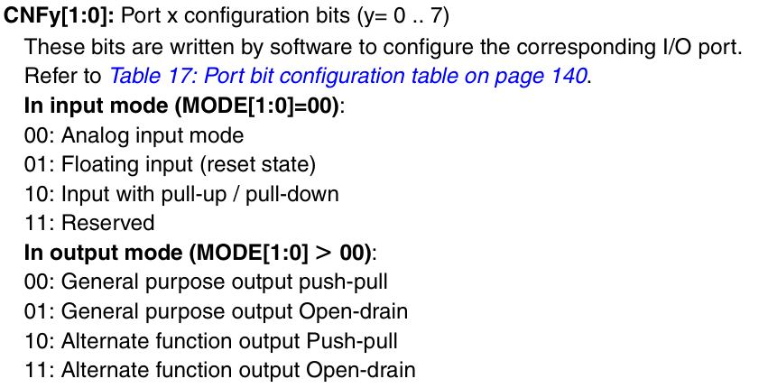
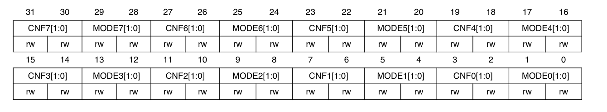
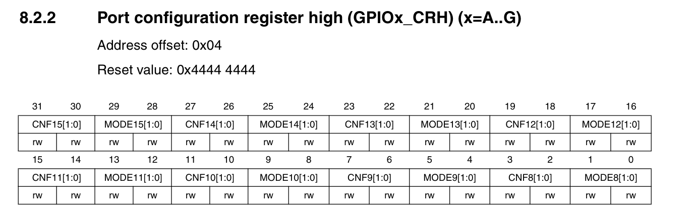

# Configuring GPIO's in the STM32F1 Chips
GPIO is the way the for the board to interact with the outside world, We have to configure the GPIO pins so that we can setup output and receive input via the GPIO Pins

## General Description
There are several sets of GPIO pins in the STM32 Blue Pill, Each GPIO Pin set has 16 GPIO pins.
For Example,
PORT A has PA0, PA1, PA2, PA3, PA4, .... PA15 has 16 Pins
Similarly, The PORT B also has 16 GPIO Pins
The base address for the Pin set are given in the manual for register access

## Essential Registers in Configuring GPIO's
- RCC_APB2ENR: APB2 Peripheral clock enable register
- GPIOx_CRL: General Purpose I/O Configuration Register Low
- GPIOx_CRH: General Purpose I/O Configuration Register High
- GPIOx_IDR: General Purpose I/O Input Data Register
- GPIOx_ODR: General Purpose I/O Output Data Register
- Here x represents the Pin Set,(x = A,B,C...G,H)

### RCC_APB2ENR
The main idea in the STM32 Blue Pill in order to not waste power is to make the clock not avaiable for the unused port, So we must turn on the clock for the Port X via this register.

- Bit 2: IOPAEN is the bit which controls the clock for the IO Port A, we have to set bit 2.
- Similarly other bits can be set for the required IOxEN.

### GPIOx_CRL
Here we configure the port to be either input, output and the kind of input and output,
- There are two main essential components, called CNFx and MODEy
- MODEy: This is the one that controls whether the GPIO pin is an input or output, and If it is an output what clock drives the output.
- CNFx: This is the register that controls, the type of input or the type of output based on the MODEy

Based on the manual, We have the values for the MODEy and CNFx

- Simiarly the Configuration for CNFx is,

- Based on these we can set the MODEy = 00 for input and CNF = 10 for pull up and pull down input modes.
- Here is the register for better understanding

- MODEy and CNFy is for the yth Port of the current Port Set.

### GPIO_CRH
- This is the exact same register but for configuring even more ports for given Port Set

### GPIO_IDR:
- This is the register that records the input take from output, This register is read when the GPIO is configured as input.
- Reading this register gives us the the data in the Input GPIO.

### GPIO_ODR
- This is similar to GPIO_IDR, but this is where we write in order to give the output via the configured GPIO Pin

## Steps to Configure the GPIO Pins
1. Turn on the Clock for the correct port set using the RCC_APB2ENR Register
2. Check the base address of the Correct GPIO Pin set in the Manual
3. Go to the GPIO_CRL or GPIO_CRH based on the pin we want to configure and write to the MODEy and CNFy properly, after clearing them
4. For output, Reading from the GPIO_ODR or write to the GPIO_ODR to check the state of the Pin or Write to the pin a value.
5. For Input, We must configure the type, Pull Up or Pull Down. For pull down write 0 to the GPIO_ODR and for Pull Up, Write 1 to the GPIO_ODR for the correct port number within the port set. Now reading from the IDR will show the data from outside.
With this the general configuration for the GPIO is over.

