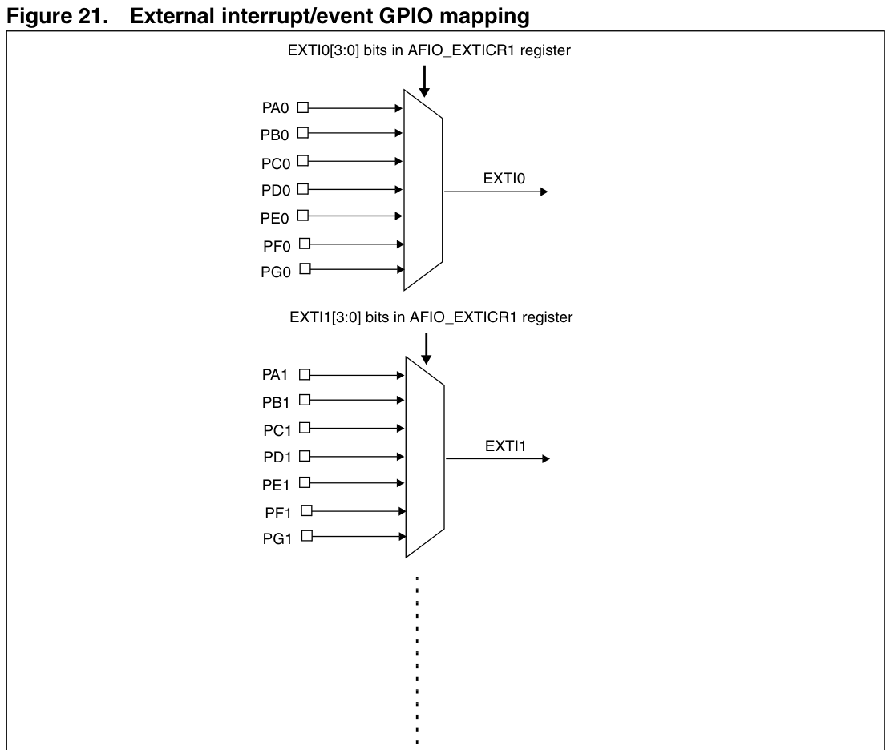
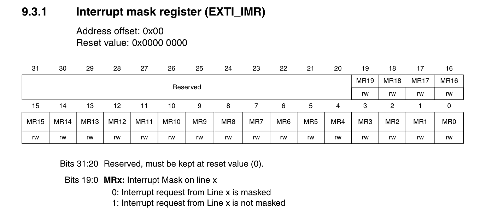
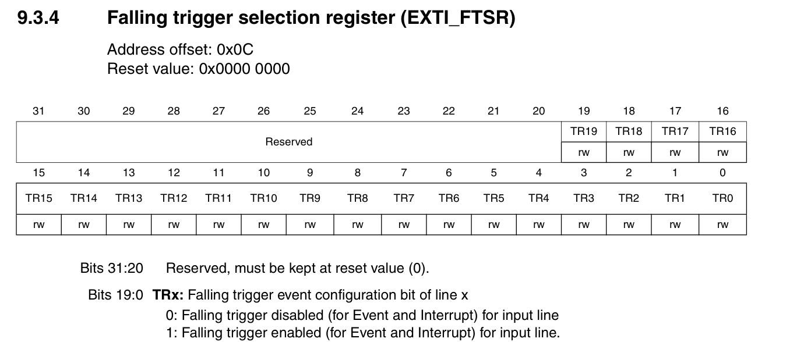
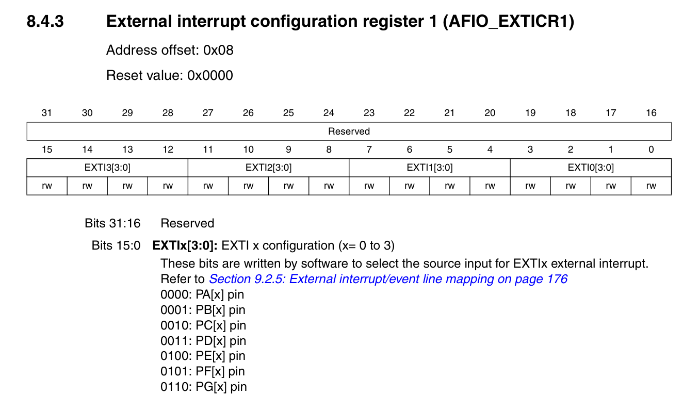

# Configuring Interrupts
The external interrupts are sent to the NVIC (Nested Vectored Interrupt Controller) via the EXTI Lines, We have to Configure the EXTIx in order to get the interrupt from button and signals outside the Blue Pill.
Essentially in the ISR Vector table we have the interrupt handlers for EXTI's already when the interrupts are triggered the Program Control goes to the EXTI Interrupt Service Routines. 
Hence we have two Configuration steps
1. Configure the GPIO Properly(see ./configuring_gpio.md)
2. Configure and Unmask the Interrupts in the Registers Related to the EXTI Lines
3. Configure the NVIC (This required another manual)

## Essential Registers to Configure the EXTI
- There are essentially 15 EXTI lines for external interrupts from GPIO pins
- Each of these lines can be connected to ports from any of the pin sets
- Example, EXTI0 Line can sample interrupts from PA0, PB0 ... PG0, Similarly for EXTI1 and so on and so forth

- The Essential Registers are
1. RCC_APB2ENR: This register has already been discussed in configuring_gpio's, In this context we must turn on the AFIOEN bit for turning on the clock for the alternate functions of the GPIO pins

2. EXTI_IMR: External Interrupts Mask Register
3. EXTI_RTSR: External Interrupts Rising trigger selection register
4. EXTI_FTSR: External Interrupts Falling Trigger selection register
5. AFIO_EXTICRx: Alternate Function I/O External Interrupt Configuration Register

### RCC_APB2ENR
- This is just for turning on the AFIO clock, we will just have to set the bit 0 of this register

### EXTI_IMR
- This is the register which either allows or masks the given EXTI line
- If a bit is set, then the EXTI interrupt line is on
- else the Interrupts to those lines are ignored.

### EXTI_RTSR
- This register Configures if they EXTI line needs to generate an interrupt if there is an Rising Edge
- If this is 1 then EXTIx line triggers interrupts at Rising Edge
- If this is 0, then no interrupts are generated at rising edge

### EXTI_FTSR
- This register configures if the EXTI line need to generate an interrupts if there is an Falling Edge.
- If this is 1 then EXTI Line interrupts are generated at falling edge of the port
- If this is 0, then EXTI line interrupts are not generated at falling edges

> [!NOTE]
> If both RTSR and FTSR are turned on, then the interrupts are sampled and generated for both the rising edge and the falling edge for the port.

### AFIO_EXTICRx
- This is the register which chooses which Port Set is used for a particular interrupt line,
- For eg, 0000 on the EXTI1 line chooses the PA1 as the point from whether changes are acknowledged and interrupts are generated.
- Similarly if EXTI2 line is present and we write 0010 then the PC2 is set as the point from which changes are acknowledged and interrupts are generated.

## Steps Involved (Till Now before configuring the NVIC Directly)
- Turn on the AFIOEN Clock in RCC_APB2ENR Register
- Use the AFIO_EXTICRx to choose the correct Port for the particular EXTI lines
- Use the FTSR or RTSR Registers to Configure the Type of Interrupts (Rising Edge Int, Falling Edge Int or both)
- Use the EXTI_IMR Register to turn on the interrupt, Unmask the interrupts

> [!NOTE]
> Before doing this, one must configure the port which is about to be used as input push/pull type.

- This itself will not trigger the interrupt we have some more registers for NVIC to Unmask and Set the Priority for.

